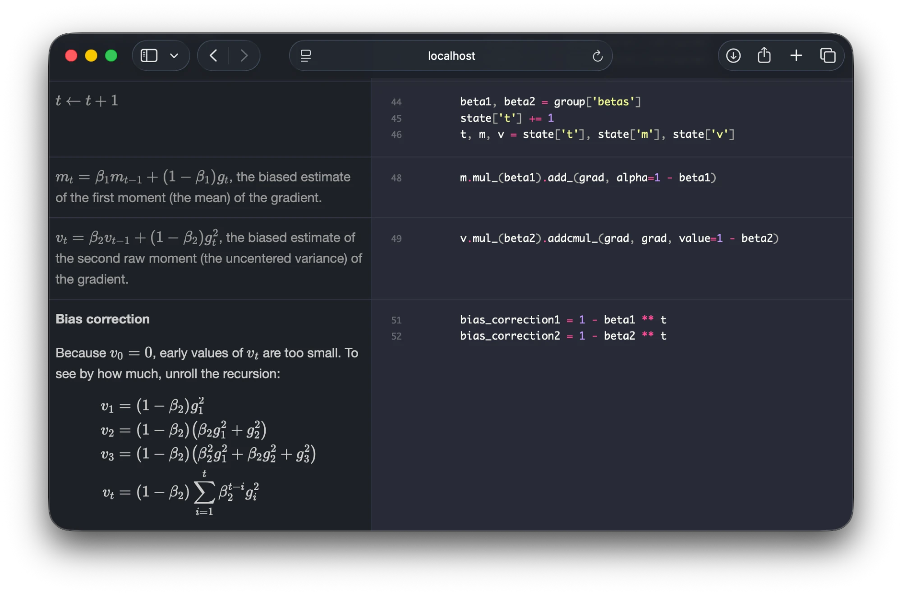
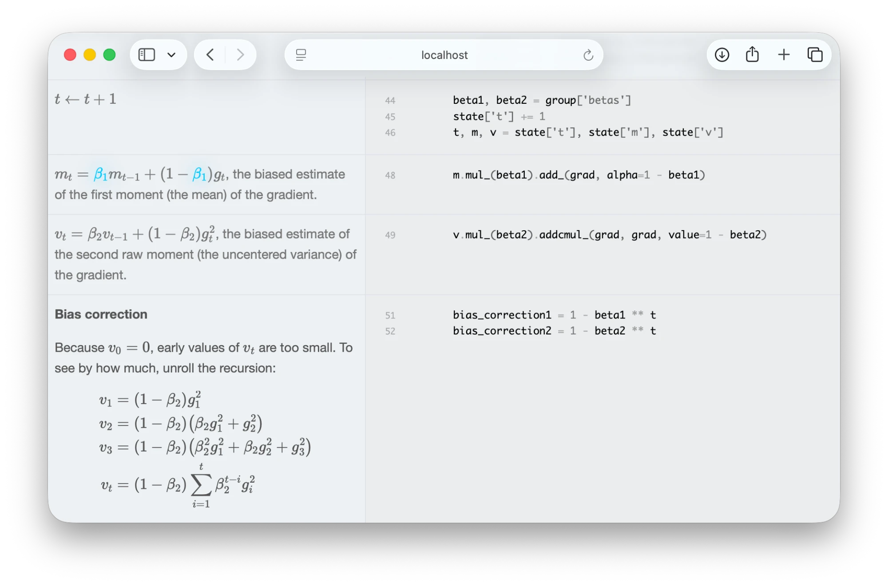

[](https://x.com/vpj)



# Annotated Research Paper Implementation

This is [Claude Code](https://claude.com/claude-code) skill to implement research paper like
[labml.ai Deep Learning Paper Implementations](https://nn.labml.ai).

[labml.ai Deep Learning Paper Implementations](https://nn.labml.ai) is a Github repo with
60+ annotated research paper implementations that with contributions from
[labml.ai](https://labml.ai) team and many outside (see [Credits](#credits)).

The labml team haven't been able to contribute to it for a few years now and the project
has become stale. I've been asking coding agents to write papers in this format since I
found it easier to follow and walk through the math and code. So decided to build this into
a skill so it's easier to use. I hope to keep maintaining it with improvements
I find useful for myself. Please feel free to contribute or fork.

## How to use

Ask Claude Code for an annotated implementation of a paper:

> Implement the Adam paper (https://arxiv.org/abs/1412.6980) as an annotated implementation.

or of code you already have:

> Turn `my_algorithm.py` into an annotated walkthrough with the math next to the code.

Claude first asks how much to implement and how deep the explanations should go, writes and tests
the code, checks in with you along the way, and then annotates each Python file and builds it into
HTML like the image above:
[Adam example](skills/annotated-implementation/examples/adam)

## Install

### Claude Code plugin (recommended)

```
/plugin marketplace add vpj/annotated_implementation_skill
/plugin install annotated-implementation@annotated-implementation
```

Restart Claude Code if it asks you to. Update later with
`/plugin marketplace update annotated-implementation`.

### Manual

Copy or symlink the skill folder into your personal skills (all projects) or one project's skills:

```bash
git clone https://github.com/vpj/annotated_implementation_skill.git
cp -r annotated_implementation_skill/skills/annotated-implementation ~/.claude/skills/
```

## Requirements

- **Python 3.8+.** The build and highlighting scripts use only the standard library.
- **`pypdf`**, used to save and extract the text of a paper (`pip install -r requirements.txt`).
- **Your implementation's own dependencies** (for example PyTorch); the skill installs nothing on
  your behalf without asking.
- **A browser** to view the HTML. Math is rendered by KaTeX, loaded from a CDN, so it needs network
  access the first time it is opened.

## Features

- **Click to highlight.** Click a symbol in an equation, or a name in the code, and every occurrence
  in the file lights up while the rest dims. Here $\beta_1$ is selected, in the light theme:

  

- **Side by side.** Each piece of explanation sits next to the exact lines of code it describes,
  with syntax highlighting and line numbers.
- **Pinned to the code.** Every section names the line it starts at and what that line says, so the
  build fails if the code changes under an explanation instead of silently going out of date.
- **Tested code.** The implementation is plain Python with tests that compare it against the
  paper's own formulas. The tests also check the paper's claims; in the Adam example they found two
  step-size bounds that don't hold.
- **Derivations and proofs at the depth you choose.** From intuition and key equations up to full
  derivations and proofs, with proofs you can expand in place.
- **You review as it goes.** Claude stops for your approval after the implementation, before
  writing derivations and proofs, and after the first annotated files.
- **Light and dark themes**, following your system setting.
- **Self-checking.** The build reports broken links and Python files without an annotation; each
  HTML file reports math that failed to render and equations too wide for their column.

## Workflow

When you ask for an annotated implementation, the skill works in five phases:

1. **Read and scope.** Saves the paper to `paper/` and plans the Python files.
2. **Scoping interview.** Asks about implementation scope, dependencies on other papers, how deep
   the documentation should go (intuition, derivations, or proofs), whether to add an experiment,
   and the framework and audience.
3. **Implement and test.** Writes plain code and tests, then stops for your review (checkpoint A).
4. **Annotate.** Shows you its plan for derivations and proofs (checkpoint B), annotates the
   overview and the core file for your review (checkpoint C), then the rest.
5. **Build and check.** Builds the HTML, checks links and rendering, and reports.

A project ends up laid out like this:

```
<topic>/
├── paper/              # paper.pdf, paper.txt (not for committing)
├── <package>/          # plain Python, each file annotated by the .doc.html next to it
│   ├── __init__.py
│   ├── __init__.doc.html
│   ├── <module>.py
│   └── <module>.doc.html
├── tests/              # correctness tests; never rendered
└── site/               # the built HTML: index.html, <module>.html
```

To build the HTML yourself:

```bash
python <skill>/scripts/build.py <package> --out site
python -m http.server --directory site
```

## Example

[`skills/annotated-implementation/examples/adam`](skills/annotated-implementation/examples/adam) is a
complete project made with this skill: Adam and AdaMax in PyTorch, with the bias-correction and
infinity-norm derivations, a sketch of the convergence proof, a small experiment with a generated
chart showing where that proof fails, and tests that found two step-size bounds in the paper that do
not hold. Build it with:

```bash
python skills/annotated-implementation/scripts/build.py \
    skills/annotated-implementation/examples/adam/adam --out site
```

## How it works

- `skills/annotated-implementation/SKILL.md`: the workflow Claude follows.
- `references/format.md`: the annotation file format. Each `<module>.doc.html` is a series of HTML
  `<section>` elements, each naming the line of `<module>.py` it starts at (`data-start`) and what
  that line contains (`data-expect`).
- `references/writing-guide.md`: how to write the prose and math.
- `scripts/build.py`: validates annotations against the code, highlights it, checks links, and
  writes one HTML file per Python file.
- `scripts/paper_text.py`: downloads a paper and extracts its text.
- `assets/`: the HTML template, stylesheet, and the script that renders math and handles clicks.
  Each HTML file also checks itself after rendering and reports problems in `window.annotationReport`.

## Development

```bash
pip install -r requirements-dev.txt
python -m pytest skills/annotated-implementation/examples/adam/tests
python skills/annotated-implementation/scripts/build.py \
    skills/annotated-implementation/examples/adam/adam --check
claude plugin validate .
```

When you change the annotation format or the assets, update the example so it keeps following the
rules; CI runs the checks above on every push.

## Credits

Contributors to [labml.ai Deep Learning Paper Implementations](https://nn.labml.ai) include:

* [@vpj](https://github.com/vpj)
* [@lakshith-403](https://github.com/lakshith-403)
* [@hnipun](https://github.com/hnipun)
* [@nmasnadithya](https://github.com/nmasnadithya)
* [@KeshSam](https://github.com/KeshSam)
* [@shakedbr](https://github.com/shakedbr)
* [@jahatef](https://github.com/jahatef)

## License

[MIT](LICENSE)
